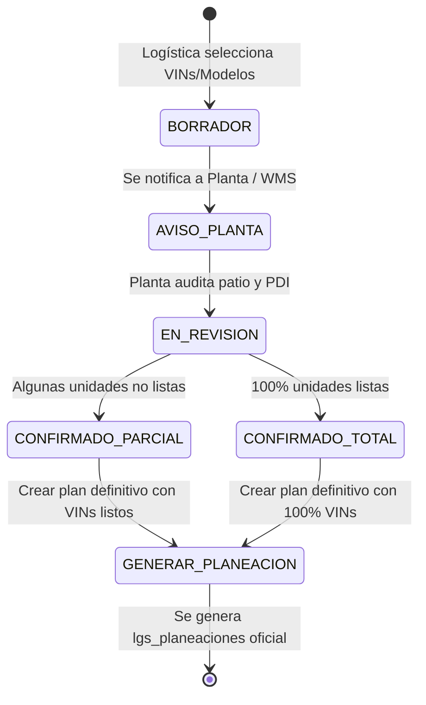

# Especificación Técnica de Integración: Preplaneación Planta & WMS

## 1. Contexto y Objetivo de Negocio
Actualmente, Logística genera planeaciones de traslado asumiendo la disponibilidad física de las unidades en patio o planta. Sin embargo, en la práctica:
- Algunas unidades aún no terminan proceso de ensamble, liberación de calidad (PDI) o trámites aduanales/fiscales.
- Se generan viajes en falso o reajustes de último momento cuando la madrina llega a recolectar y las unidades no están listas.

**Objetivo:** Implementar una etapa previa (**Preplaneación**) donde Logística selecciona tentativamente VINs y Modelos, emite un aviso formal a Planta/WMS, y Planta confirma individualmente qué unidades sí estarán listas para la fecha estimada antes de emitir la Planeación Definitiva.

---

## 2. Flujo de Trabajo (State Machine)



---

## 3. Modelo de Datos Propuesto

### Tabla: `lgs_preplaneaciones`
| Campo | Tipo | Descripción |
|---|---|---|
| `id_preplaneacion` | INT AUTO_INCREMENT PK | Identificador único |
| `folio` | VARCHAR(30) UNIQUE | Ej: `PRE-2026-0001` |
| `id_planta_origen` | INT | FK a `mrp_planta` / `lgs_cat_ubicaciones` |
| `id_destino` | INT | FK a `lgs_cat_ubicaciones` |
| `id_trasladista` | INT NULL | Trasladista preliminar tentativo |
| `fecha_tentativa_salida`| DATETIME | Fecha programada para recolección |
| `estado` | ENUM | `'BORRADOR'`, `'ENVIADO_PLANTA'`, `'CONFIRMADO'`, `'PLANEADO'`, `'CANCELADO'` |
| `total_vins_solicitados`| INT | Total de unidades solicitadas |
| `total_vins_confirmados`  | INT DEFAULT 0 | Unidades listas según Planta |
| `observaciones` | TEXT NULL | Notas de logística |
| `respuesta_planta` | TEXT NULL | Notas del supervisor de patio/planta |
| `created_by` | INT | Usuario logística |
| `created_at` | DATETIME | Fecha de creación |
| `updated_at` | DATETIME | Última actualización |

### Tabla: `lgs_preplaneaciones_vins`
| Campo | Tipo | Descripción |
|---|---|---|
| `id_preplaneacion_vin` | INT AUTO_INCREMENT PK | Identificador único |
| `id_preplaneacion` | INT | FK `lgs_preplaneaciones.id_preplaneacion` |
| `vin` | VARCHAR(17) | VIN de la unidad |
| `modelo` | VARCHAR(100) | Modelo de la unidad |
| `color` | VARCHAR(50) | Color de la unidad |
| `disponible_planta` | TINYINT(1) DEFAULT 0 | 0 = No lista / 1 = Lista y confirmada |
| `motivo_no_disponible`| VARCHAR(255) NULL | 'En PDI', 'Retención Calidad', 'Falta Batería', etc. |
| `confirmado_by` | INT NULL | Usuario de Planta / WMS que validó |
| `confirmado_at` | DATETIME NULL | Fecha y hora de validación |

---

## 4. Contrato de API (Endpoints)

### 4.1. Crear Preplaneación (Logística)
- **Ruta:** `POST /Lgs_preplaneaciones/crear`
- **Payload:**
```json
{
  "id_planta_origen": 1,
  "id_destino": 14,
  "fecha_tentativa_salida": "2026-11-10 09:00:00",
  "observaciones": "Solicitud para ruta Bajío",
  "vins": [
    {"vin": "3N1AB8CV8RY100001", "modelo": "Sedan X"},
    {"vin": "3N1AB8CV8RY100002", "modelo": "SUV Y"}
  ]
}
```

### 4.2. Notificar a Planta (Disparo de Alerta)
- **Ruta:** `POST /Lgs_preplaneaciones/notificarPlanta`
- **Payload:** `{"id_preplaneacion": 45}`
- **Acción:** Envía correo al Director de Planta (`idrol = 8`) y encargados de Patio WMS con la lista de VINs a preparar.

### 4.3. Validación / Confirmación de Planta (Planta / WMS)
- **Ruta:** `POST /Lgs_preplaneaciones/confirmarDisponibilidad`
- **Payload:**
```json
{
  "id_preplaneacion": 45,
  "respuesta_planta": "8 unidades listas en rampa 2, 2 unidades retenidas en PDI por software.",
  "unidades": [
    {"vin": "3N1AB8CV8RY100001", "disponible": 1, "motivo": ""},
    {"vin": "3N1AB8CV8RY100002", "disponible": 0, "motivo": "Falta liberación de software PDI"}
  ]
}
```

### 4.4. Conversión a Planeación Definitiva (Logística)
- **Ruta:** `POST /Lgs_preplaneaciones/convertirAPlaneacion`
- **Payload:**
```json
{
  "id_preplaneacion": 45,
  "solo_confirmados": true,
  "id_trasladista": 4,
  "tipo_unidad_transporte": "Madrina 8"
}
```
- **Resultado:**
  - Se genera el registro en `lgs_planeaciones` con folio oficial (`PLN-2026-XXXX`).
  - Se vinculan únicamente las unidades confirmadas en `lgs_planeaciones_vins`.
  - La preplaneación pasa a estado `'PLANEADO'`.

---

## 5. Roles y Permisos Involucrados
- **Logística (`idrol = 65, 67, 70`):** Crea preplaneaciones, envía avisos y convierte preplaneaciones en planes definitivos.
- **Planta / Calidad (`idrol = 8, 12, 14`):** Recibe notificaciones y confirma/rechaza la disponibilidad física de cada VIN en patio.
- **Administrador (`idrol = 1`):** Acceso total y supervisión del pipeline completo.

