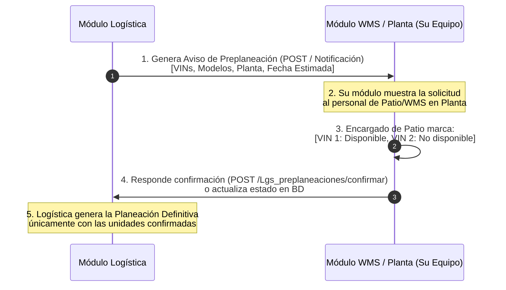

# Requerimiento de Integración: Preplaneación de Unidades para Planta
**Para:** Equipo de Desarrollo de WMS / MRP Producción  
**De:** Equipo de Desarrollo de Logística MRP  
**Fecha:** 2026-11-02  
**Objetivo:** Establecer el contrato de integración para el aviso de preplaneación de unidades entre Logística y Planta/WMS, evitando despachos fallidos o unidades no disponibles al momento de carga.

---

## 1. Contexto y Necesidad Operativa

Actualmente, Logística genera planeaciones de embarque sin tener confirmación previa de si la unidad terminada en Planta ya cuenta con liberación física, inspección PDI o si tiene algún faltante en patio. 

Para resolverlo, **Logística emitirá un aviso previo (Preplaneación)** y **WMS / Planta deberá responder confirmando si las unidades estarán listas o no** para la fecha tentativa de recolección.

---

## 2. Diagrama de Responsabilidades



---

## 3. Lo que Logística ya tiene preparado para ustedes

Desde el módulo de Logística proporcionamos las siguientes tablas y endpoints para la integración:

### A. Estructura de Base de Datos Compartida
* **Tabla Cabecera:** `lgs_preplaneaciones`
  * `id_preplaneacion` (PK)
  * `folio` (ej. `PRE-2026-0001`)
  * `id_planta` (ID de planta de origen de `mrp_planta`)
  * `fecha_tentativa_recoleccion` (DATETIME)
  * `id_estado` (`1`: Enviado a Planta, `2`: Confirmado por Planta, `3`: Convertido a Planeación)
* **Tabla Detalle:** `lgs_det_preplaneaciones_vins`
  * `id` (PK)
  * `id_preplaneacion` (FK)
  * `id_unidad` / `vin` / `modelo`
  * `disponible_planta` (`1`: Sí disponible, `0`: No disponible, `NULL`: Pendiente de revisión)
  * `motivo_no_disponible` (VARCHAR: *Falta componente*, *Retrabajo*, *PDI pendiente*, etc.)
  * `confirmado_by` (ID usuario de planta)
  * `confirmado_at` (DATETIME)

---

## 4. Lo que necesitamos que desarrolle el Equipo de WMS / Planta

Ustedes en su módulo (WMS / Planta) solo deben implementar **una pantalla o componente sencillo**:

### A. Pantalla / Pestaña en WMS: *"Solicitudes de Embarque Logística"*
1. **Listado de Preplaneaciones Pendientes:**
   * Filtrar por la planta correspondiente al usuario logueado (`mrp_planta`).
   * Mostrar: Folio, Fecha tentativa de carga, total de unidades solicitadas.
2. **Acción de Validación por Unidad:**
   * Al hacer clic en revisar una solicitud, mostrar la lista de VINs y modelos solicitados.
   * Para cada VIN, un switch/radio:
     * 🟢 **Sí llega / Listo en patio**
     * 🔴 **No llega** (con un select obligatorio de motivo: *En ensamble*, *Falta componente*, *Retrabajo*, *PDI no liberado*).
3. **Botón:** *"Confirmar Disponibilidad a Logística"*.

---

## 5. Contrato de Integración (API / Endpoint)

Al hacer clic en *"Confirmar Disponibilidad a Logística"*, su interfaz puede invocar este endpoint de Logística vía AJAX/JSON:

* **URL:** `{{base_url}}/Lgs_preplaneaciones/confirmarDisponibilidad`
* **Método:** `POST`
* **Headers:** `Content-Type: application/json`
* **Payload de Ejemplo:**

```json
{
  "id_preplaneacion": 15,
  "usuario_id": 42,
  "comentarios_planta": "VIN ...001 y 002 liberados en patio norte; VIN ...003 en espera de moldura.",
  "unidades": [
    {
      "vin": "3N1AB7AP8KY100001",
      "disponible": true,
      "motivo": null
    },
    {
      "vin": "3N1AB7AP8KY100002",
      "disponible": true,
      "motivo": null
    },
    {
      "vin": "3N1AB7AP8KY100003",
      "disponible": false,
      "motivo": "Falta de componente / PDI pendiente"
    }
  ]
}
```

* **Respuesta Exitosa de Logística:**
```json
{
  "status": true,
  "code": 200,
  "message": "Disponibilidad confirmada correctamente. Logística ha sido notificada para generar la planeación definitiva."
}
```

---

## 6. Siguientes Pasos
1. Entregar este documento al líder o desarrollador a cargo de WMS / MRP.
2. En Logística dejamos creado el endpoint `POST /Lgs_preplaneaciones/confirmarDisponibilidad` y la interfaz del Planeador para emitir el aviso y convertir los confirmados a Planeación Definitiva.

