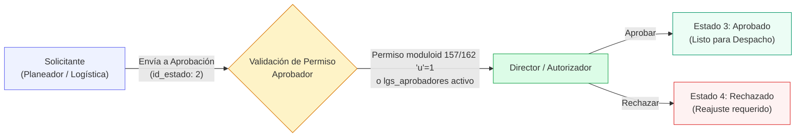
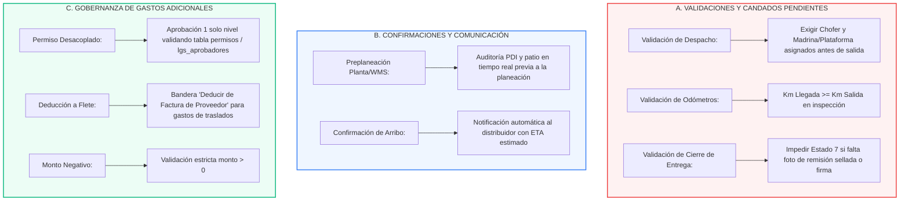

# Flujo Operativo y de Estados Logística MRP (2026-11-02 13:00)
**Empresa:** LDR Solutions / MRP  
**Módulos Analizados:** Mis Envíos (`Lgs_envios`), Mis Planeaciones (`Lgs_planeaciones`), Aprobaciones (`Lgs_aprobaciones`), Mesa de Despacho (`Lgs_ejecucion`), Evidencias y Cierre (`Lgs_evidencias`), Incidencias (`Lgs_incidencias`), Gastos Adicionales (`Lgs_gastosadicionales`).

---

## 1. Arquitectura de Aprobaciones de 1 Solo Nivel (Basada en Permiso)

### Regla de Negocio
- **Nivel Único:** El flujo no tiene cadenas jerárquicas multinivel; pasa directamente de **Solicitante a Aprobador**.
- **Permiso Desacoplado:** La capacidad de aprobar **NO está casada con una persona ni con un puesto específico**. Se valida dinámicamente:
  1. Si el rol tiene permiso `u` (update/aprobar) en el módulo correspondiente (`moduloid = 157` para Planeaciones o `162` para Gastos).
  2. Si el usuario está registrado en la tabla de autorizadores (`lgs_aprobadores.activo = 1`).
  3. Superusuario Administrador (`rolid = 1`).
- **Segregación de Funciones:** Quien crea/solicita la planeación o el gasto **nunca puede auto-aprobarse**.

---

## 2. Diagrama del Flujo Actual Completo (100% Operativo)

```mermaid
flowchart TD
    subgraph FASE1["1. CREACIÓN Y PLANEACIÓN"]
        A["Bandeja de Unidades Disponibles<br>(mrp_unidades_terminadas)"] --> B["Creación de Envíos (Lgs_envios)<br>Orígenes y Destinos Unificados (Plantas y Almacenes)"]
        B --> C["Planificador de Envíos / Agrupación (Lgs_planeaciones)<br>Asignación de Trasladista, Madrina y Chofer"]
        C --> D{"¿Enviar a Aprobación?"}
        D -- Sí --> E["Estado: EN APROBACIÓN (id_estado: 2)<br>Alerta a usuarios con permiso de aprobación"]
        D -- Borrador --> C
    end

    subgraph FASE_APROBACION["2. GOBERNANZA Y REAPERTURA"]
        E --> F{"Decisión Aprobador (Permiso Activo)<br>Segregación: Creador != Aprobador"}
        F -- Rechazar --> G["Estado: RECHAZADO / CANCELADO (id_estado: 4)"]
        F -- Aprobar --> H["Estado: APROBADO (id_estado: 3)"]
        
        %% Ciclo de Reapertura
        H -.->|"Solicitud de Reapertura<br>(Select Motivo + Justificación Abierta)"| R1["Modal Reapertura (Mis Planeaciones)"]
        R1 -.->|"Alerta Mail a Autorizadores + Retorno a Edición"| C
    end

    subgraph FASE_EXCEPCIONES["3. PAUSAS Y CANCELACIONES"]
        H --> PAUSA_CHECK{"¿Incidencia o Bloqueo?"}
        PAUSA_CHECK -- "Pausar Envío" --> PAUSADO["Estado: PAUSADO<br>(Motivo obligatorio + Auditoría)"]
        PAUSADO -- "Reanudar" --> H
        PAUSA_CHECK -- "Cancelar Envío" --> CANCELADO["Estado: CANCELADO<br>(Liberación de VINs al patio)"]
        PAUSA_CHECK -- "Normal" --> I["Programación de Recolección (id_estado: 5)"]
    end

    subgraph FASE2["4. MESA DE DESPACHO Y CONTROL EN PLANTA"]
        I --> DESP_FILTER["Mesa de Despacho (Lgs_ejecucion)<br>Filtrado estricto por Sede/Planta asignada al usuario"]
        DESP_FILTER --> CITA_CHECK{"¿Cita en Destino Confirmada?<br>(confirmado_destino == 1)"}
        
        CITA_CHECK -- No --> MODAL_CITA["BLOQUEO ESTRICTO DE SALIDA<br>Modal Confirmar Cita (Contacto + Fecha/Hora + Notas)"]
        MODAL_CITA --> CITA_CHECK
        
        CITA_CHECK -- Sí --> ACOMODO["Planilla de Acomodo de Madrina<br>Inspección 5 Puntos de Calidad por VIN"]
        ACOMODO --> VALIDAR_VIN["Confirmación individual de VIN<br>(Carga física en transporte)"]
        VALIDAR_VIN --> CHECK_ULTIMA{"¿Última Unidad del Envío?"}
        
        CHECK_ULTIMA -- No --> ACOMODO
        CHECK_ULTIMA -- Sí --> NOTIF_COMPLETA["Alerta Email a Logística:<br>CARGA COMPLETA EN MADRINA"]
        NOTIF_COMPLETA --> SALIDA_RUTA["Estado 6: EN TRÁNSITO / EJECUTADO<br>Registro de Fecha y Hora Real de Salida"]
    end

    subgraph FASE_INCIDENCIAS_GASTOS["5. GESTIÓN EN RUTA: INCIDENCIAS Y GASTOS"]
        SALIDA_RUTA --> EN_RUTA{"¿Ocurrió evento en trayecto?"}
        
        %% Incidencias
        EN_RUTA -- "Incidencia" --> INC_REG["Registro de Incidencia (Lgs_incidencias)<br>Siniestro, Mecánica, Clima, etc."]
        INC_REG --> INC_FILES["Carga Múltiple de Fotos y Evidencias"]
        INC_FILES --> INC_ZIP["Descarga Consolidada en Archivo ZIP"]
        INC_REG --> TIENE_COSTO{"¿Genera Costo Extra?"}
        
        %% Gastos Adicionales
        TIENE_COSTO -- Sí --> GASTO_REG["Registro Gasto Adicional (Lgs_gastosadicionales)"]
        EN_RUTA -- "Gasto Independiente" --> GASTO_REG
        
        GASTO_REG --> MODO_GASTO{"Modo de Captura"}
        MODO_GASTO -- "Catálogo" --> TARIFA_FIJA["Tarifa Fija / Concepto Homologado"]
        MODO_GASTO -- "Motivos Abiertos" --> LIBRE["Switch Abierto: Concepto y Monto Manual"]
        
        TARIFA_FIJA --> GASTO_APROB["Aprobación de Gasto Extra<br>1 Solo Nivel: Usuario con Permiso<br>(Segregación: Creador != Aprobador)"]
        LIBRE --> GASTO_APROB
        GASTO_APROB --> ABSORCION["Definición de Absorción:<br>LDR / Proveedor / Cliente / Aseguradora"]
    end

    subgraph FASE3["6. EVIDENCIAS, RECEPCIÓN Y CIERRE"]
        SALIDA_RUTA --> LLEGADA["Llegada a Destino"]
        ABSORCION --> LLEGADA
        EN_RUTA -- "Sin Incidencias" --> LLEGADA
        
        LLEGADA --> MOD_EVIDENCIAS["Módulo Evidencias y Cierre (Lgs_evidencias)"]
        
        MOD_EVIDENCIAS --> EVID_OPCIONES["Acciones por Envío / VIN:"]
        EVID_OPCIONES --> BTN_VER_PLANTA["1. Ver Fotos Entrega Planta"]
        EVID_OPCIONES --> BTN_ENTR_PLANTA["2. Captura Inspección Patio"]
        EVID_OPCIONES --> BTN_RECIBO_TRAS["3. Acuse Recibo Trasladista (Chofer)"]
        EVID_OPCIONES --> BTN_DESTINO["4. Entrega Destino (Distribuidor / Cliente)"]
        EVID_OPCIONES --> BTN_PDF["5. Descarga Hoja de Entrega / Traspaso PDF"]
        
        BTN_DESTINO --> CIERRE_FINAL["Firma de Receptor + Sello Remisión"]
        CIERRE_FINAL --> ESTADO_7["Estado 7: ENTREGADO / FINALIZADO<br>Unidades pasan a estado físico ENTREGADO"]
    end

    %% ESTILOS
    style FASE1 fill:#F8FAFC,stroke:#94A3B8,stroke-width:2px
    style FASE_APROBACION fill:#EFF6FF,stroke:#3B82F6,stroke-width:2px
    style FASE_EXCEPCIONES fill:#FEF2F2,stroke:#EF4444,stroke-width:2px
    style FASE2 fill:#F0FDF4,stroke:#10B981,stroke-width:2px
    style FASE_INCIDENCIAS_GASTOS fill:#FFFBEB,stroke:#F59E0B,stroke-width:2px
    style FASE3 fill:#F5F3FF,stroke:#8B5CF6,stroke-width:2px
```

---

## 3. Diagrama de Mejoras y Puntos Identificados (Roadmap y Brechas)

---

## 4. Estado de Implementación
- **Fecha de Corte:** 2026-11-02 13:00.
- **Entorno:** Docker `mrp-app` con base de datos MySQL 8.0 `mrp-db`.
- **Todos los módulos sincronizados y probados con sintaxis PHP y JS 100% limpia.**
